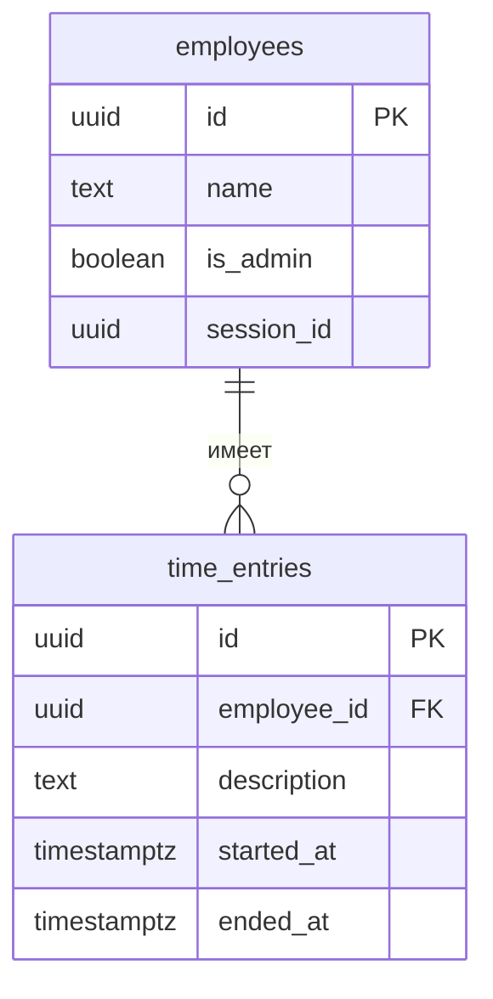

# База данных

Приложение использует PostgreSQL в Supabase. Схема описана последовательными SQL-миграциями в [`supabase/migrations`](../supabase/migrations/). Клиент обращается к базе через Supabase RPC; серверные функции выполняют проверки и изменения внутри PostgreSQL.

## Схема

### `employees`

| Поле | Назначение |
| --- | --- |
| `id` | Первичный ключ UUID, создаётся автоматически. |
| `name` | Обязательное имя без пробелов по краям; уникально без учёта регистра после обрезки пробелов. |
| `is_admin` | Признак администратора; по умолчанию `false`. |
| `session_id` | UUID текущей сессии или `NULL`. Новый вход заменяет прежнее значение. |

Первая миграция создаёт сотрудника «Администратор». Серверная функция управления ролями не разрешает снять роль с последнего администратора.

### `time_entries`

| Поле | Назначение |
| --- | --- |
| `id` | Первичный ключ UUID, создаётся автоматически. |
| `employee_id` | Обязательная ссылка на `employees.id`. |
| `description` | Обязательное непустое описание задачи. |
| `started_at` | Обязательное начало интервала, `timestamptz`. |
| `ended_at` | Окончание интервала, `timestamptz`; `NULL` означает активный таймер. |

Для одного сотрудника интервалы не пересекаются. Ограничение GiST использует полуоткрытые диапазоны `[начало, окончание)`: соседние интервалы разрешены, активный интервал открыт в будущее. Частичный уникальный индекс дополнительно ограничивает сотрудника одним активным таймером. Для завершённого интервала окончание должно быть строго позже начала.

Триггер `time_entries_seconds` приводит начало и окончание к точности до секунды, отбрасывая дробную часть. Если после этого окончание не позже начала, операция отклоняется; в частности, остановка в ту же секунду может не пройти.

## Сессии и доступ

При входе `login` записывает переданный клиентом UUID в `employees.session_id`. `require_session` блокирует строку сотрудника и проверяет совпадение идентификаторов; при несовпадении возвращается `SESSION_REVOKED`. Следующий вход того же сотрудника заменяет предыдущую сессию, но не останавливает его таймер. `logout` очищает идентификатор только при совпадении с текущим.

На таблицах включена RLS, а прямые права на них отозваны у ролей `anon` и `authenticated`. Приложение работает через функции `SECURITY DEFINER`, которые явно проверяют сессию и права там, где это предусмотрено. `employee_list` и `login` доступны до входа; внутренний `require_session` не предоставляется как публичная функция API.

**Ограничение безопасности:** выбор имени не подтверждает личность. Имеющий доступ к приложению или публичному API может войти как другой сотрудник, включая администратора. Текущая схема предназначена для демонстрации в доверенной среде; для реальной эксплуатации нужны полноценная аутентификация и соответствующие правила доступа.

## Функции RPC

| Функции | Назначение |
| --- | --- |
| `employee_list`, `login`, `session_info`, `logout` | Список сотрудников и работа с сессией. |
| `add_employee`, `set_admin` | Добавление сотрудников и управление ролями администратором. |
| `start_timer`, `stop_timer` | Запуск и остановка собственного таймера по серверному времени. |
| `update_entry`, `delete_entry` | Изменение и удаление только собственных завершённых записей. При изменении проверяются описание, границы, будущее окончание и пересечения. |
| `report_entries` | Записи, пересекающиеся с заданным периодом: свои для сотрудника, все для администратора. |
| `active_entry` | Собственный активный таймер. |
| `employee_intervals` | Границы всех собственных записей для клиентской проверки редактирования. |
| `entries` | Первоначальная функция получения доступной истории; текущий клиент использует функции периода и активного таймера. |

Проверки клиента повышают удобство, но параллельные действия и ограничения целостности разрешаются базой. При запросах отчёта и интервалов клиент использует постраничное чтение.

## Миграции и настройка

1. `20261030000000_time_tracking.sql` создаёт таблицы, индексы, ограничения, функции и начального администратора.
2. `20261031000000_report_and_seconds.sql` приводит существующие интервалы к секундам, обновляет ограничение пересечения и добавляет триггер и функции для отчёта. Миграция выполняется в транзакции и останавливается, если существующий завершённый интервал после округления стал бы нулевым; такие записи нужно исправить до повторного выполнения.

На новой базе миграции применяются по порядку. Параметры клиентского подключения и команды запуска описаны в [README](../README.md). Пароли базы и приватные ключи не должны попадать в код клиента или документацию.
