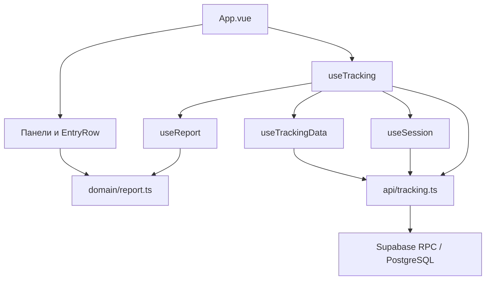

# Архитектура фронтенда

Документ описывает текущее устройство клиентской части Falcon. Приложение написано на Vue 3 с Composition API и TypeScript; Vite отвечает за разработку и сборку, Tailwind CSS — за оформление. Это одностраничное приложение без отдельного маршрутизатора и библиотеки глобального состояния.

## Структура

```text
src/
├── main.ts              # Создание и запуск приложения Vue
├── App.vue              # Компоновка экрана и связь панелей с действиями
├── components/          # Панели и строка записи
├── composables/         # Сессия, данные, действия и состояние отчёта
├── domain/report.ts     # Работа с датами, длительностью и интервалами
├── api/                 # Клиент Supabase и обёртка над RPC-функциями
├── types.ts             # Общие типы Employee, Entry, Interval и Session
└── style.css            # Tailwind и общие классы интерфейса
```

Состояние создаётся внутри `useTracking()` и используется корневым компонентом. Данные и обработчики передаются дочерним компонентам через свойства и события. Большинство бизнес-правил вынесено из шаблонов, однако компоненты сохраняют локальное состояние формы и логику представления.



## Компоненты

| Компонент | Ответственность |
| --- | --- |
| `App.vue` | Выбирает экран входа или рабочую область, передаёт состояние и действия панелям, показывает ошибки и повторную загрузку. |
| `AppHeader.vue` | Показывает сотрудника и кнопку выхода. |
| `LoginPanel.vue` | Выбор сотрудника и отправка события входа; отражает загрузку списка. |
| `TimerPanel.vue` | Форма запуска и текущий таймер, события запуска и остановки. |
| `AdminPanel.vue` | Добавление сотрудника и управление ролями; отображается администратору. |
| `ReportPanel.vue` | Выбор периода и группы отчёта по сотрудникам. |
| `EntryRow.vue` | Просмотр, редактирование и удаление отдельной записи; запрашивает границы интервалов перед редактированием. |

Свойства `busy` и `operation` помогают отключать действия на время запроса и показывать соответствующий текст. Загрузка, ошибка и пустое состояние отображаются отдельно.

## Состояние и действия

- `useSession` создаёт идентификатор сессии при входе, хранит его вместе с ID сотрудника в `sessionStorage` и очищает при выходе или отзыве сессии. Это хранение привязано к сессии вкладки браузера.
- `useTrackingData` загружает сотрудника, список команды, записи отчёта и активный таймер. Он хранит состояния начальной загрузки, обновления, выполняемой операции и ошибки; предоставляет повторную загрузку и отдельную загрузку интервалов для редактирования.
- `useReport` группирует записи по сотрудникам, считает длительности внутри периода и обновляет текущее время раз в секунду. Таймер очищается при уничтожении компонента.
- `useTracking` соединяет эти composables, хранит выбранные даты и предоставляет действия входа, выхода, управления сотрудниками, таймером и записями.

При открытии приложения выполняется загрузка, затем данные обновляются раз в 15 секунд, если не выполняется операция или обновление. Изменение периода запускает новую загрузку отчёта. Каждый запрос обновления получает номер поколения: устаревший ответ или ответ от предыдущей сессии не применяется. После успешного действия обновление выполняется отдельно; если оно не удалось, интерфейс сообщает, что действие выполнено, но данные не обновлены.

## API и потоки данных

`api/supabase.ts` создаёт клиент из `VITE_SUPABASE_URL` и `VITE_SUPABASE_ANON_KEY`. `api/tracking.ts` вызывает именованные функции PostgreSQL через Supabase RPC и преобразует серверные ошибки в ошибки приложения. Публичный ключ доступен в браузере; секреты базы и service role key в клиент не помещаются.

При входе клиент генерирует UUID сессии и передаёт его вместе с ID сотрудника. В последующих защищённых запросах передаются оба значения. После отзыва сессии сервер возвращает `SESSION_REVOKED`, клиент очищает локальную сессию и возвращается к экрану входа.

Для отчёта отправляются границы выбранного периода: `report_entries` возвращает пересекающиеся с ним записи. Активный таймер загружается отдельно через `active_entry`, а при редактировании собственные границы интервалов — через `employee_intervals`. Для списков отчёта и интервалов клиент последовательно запрашивает страницы. Итоговые длительности и обрезка по периоду рассчитываются на клиенте.

## Время и проверка интервалов

`domain/report.ts` формирует локальные границы календарных дней с исключающей верхней границей, рассчитывает длительность пересечения записи и периода и форматирует время. Выбранные даты и отображаемое время зависят от часового пояса устройства; запросы к API передают моменты времени в ISO-формате.

При редактировании клиент проверяет порядок границ, будущее время и пересечения с другими интервалами сотрудника, включая активный таймер. Соседние интервалы допустимы. Некорректные границы выделяются, сохранение отключается. Это предварительная проверка: база повторно проверяет ограничения при сохранении и остаётся источником истины при устаревших данных или параллельных действиях.

## Стили и проверки

Общие классы, в том числе `card`, `input` и `button`, находятся в `style.css`; остальная вёрстка использует классы Tailwind с подходом mobile-first. Тесты в `tests/` проверяют расчёты и состояние приложения; для проверки таймера API подменяется. Команды: `npm test`, `npm run build`, `npm run format:check`.

О схеме, функциях и ограничениях данных см. [описание базы данных](database.md).
